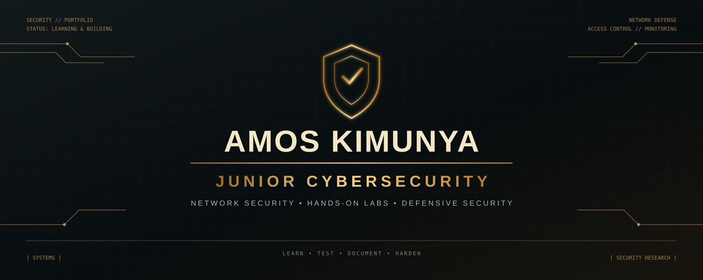

<h1 align="center">Hi 👋, I'm Amos</h1>

## 🚀 About Me

- 💻 Cybersecurity Learner
- 🛡️ Bug Bounty Hunter

---

## 🛠 Skills
- 🔍 Recon & Scanning
- 🐞 Bug Hunting
- 🌐 Web Exploitation
- 🐧 Kali Linux
- VLAN configuration
- Active Directory management
- Network security hardening
- Wireless security Testing
- Malware analysis 

---

## 📚 Currently Learning
- Network security 
- Advanced Nmap Scanning
- Web Exploitation Labs
- Privilege Escalation

## Certificatiom 
 1 I am Cisco certified in ETH, Network and defence at depth. 

### Build things. Ship them. Let real users decide.

**Network Penetration Testing  · AI Automation · Malware analyst · Linux Automation · ETH · Android Pentester**

  
  
  

  
  
 

        
